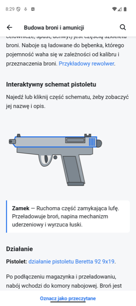
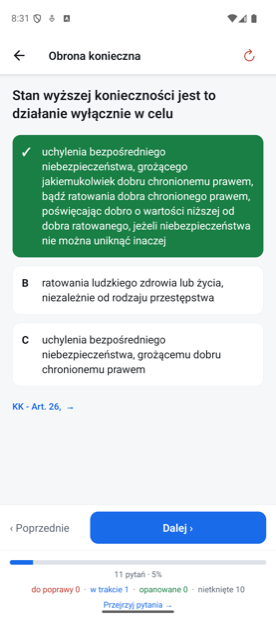
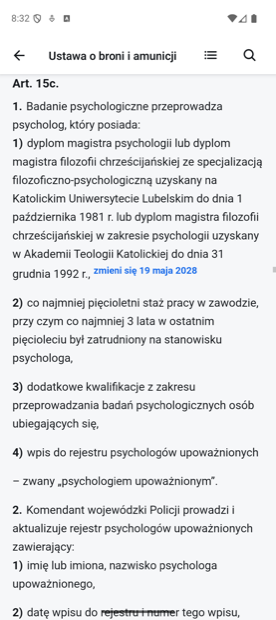
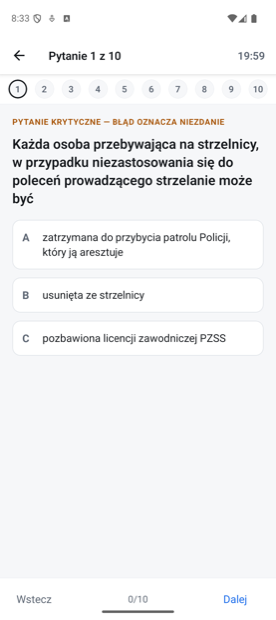

# Patent Strzelecki

Aplikacja na Androida do nauki na teoretyczną część egzaminu na patent strzelecki PZSS
i na pozwolenie na broń (WPA). Działa bez internetu i bez zakładania konta. Jest bezpłatna,
nie ma reklam i niczego nie wysyła.

## Co jest w aplikacji

- cała teoria kursu w 11 lekcjach,
- fiszki i test ABC z powtórkami,
- egzamin próbny na patent według § 19 regulaminu PZSS i egzamin próbny na WPA,
- wyniki według zagadnień, które pokazują, gdzie jest najwięcej błędów,
- pełne teksty ustawy o broni i amunicji, Kodeksu karnego, Kodeksu wykroczeń i dwóch
  rozporządzeń, z przejściem z pytania prosto do wskazanego przepisu,
- wyszukiwarka po lekcjach, pytaniach i przepisach.

Wersji na iPhone'a nie ma. Kurs, z którego pochodzą treści, działa w przeglądarce
na [patentstrzelecki.eu](https://patentstrzelecki.eu/).

| | | | |
| --- | --- | --- | --- |
|  |  |  |  |
| Lekcja | Test ABC | Ustawa offline | Egzamin próbny |

## Skąd są treści

Treść pochodzi z bezpłatnego kursu [patentstrzelecki.eu](https://patentstrzelecki.eu/)
prowadzonego przez Braterstwo (Stowarzyszenie KS Amator) i jest używana za zgodą autorów
kursu. Aplikacja jest **nieoficjalna**: Braterstwo jej nie prowadzi i nie odpowiada za jej
działanie. Napisał ją Hubert Książek; błędy i uwagi idą do autora aplikacji, nie do autorów
kursu.

- [Polityka prywatności](polityka-prywatnosci)
- [Kod źródłowy na GitHubie](https://github.com/Gdahuks/patent-strzelecki)

Google Play i logo Google Play są znakami towarowymi Google LLC.
